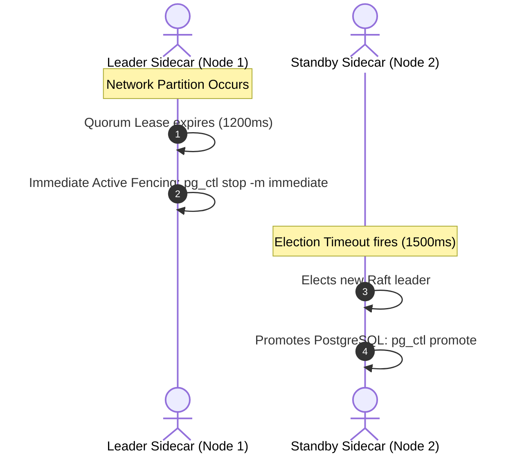

# PgVisor Architecture & Specification

## 1. System Overview

**PgVisor** is a lightweight, simplified PostgreSQL High Availability (HA) cluster supervisor, L7 wire protocol proxy, and cloud backup pipeline built in Rust. It replaces the operational sprawl of Patroni, PgBouncer, Consul/Etcd, and pgBackRest with a unified, cohesive binary architecture.

```mermaid
graph TD
    Client["PostgreSQL Clients (psql / Applications)"] -->|Postgres Wire Protocol 3.0 (:5432)| Proxy["pgvisor-proxy (SQL-Only Port 5432)"]
    Proxy -->|Read-Write Queries| LeaderPG["PostgreSQL Leader (Port 5432)"]
    Proxy -->|Read-Only Queries| StandbyPG1["PostgreSQL Standby 1 (Port 5432)"]
    Proxy -->|Read-Only Queries| StandbyPG2["PostgreSQL Standby 2 (Port 5432)"]

    subgraph Node1 ["Node 1 (Leader)"]
        Sidecar1["pgvisor-sidecar (PID 1)\n/control :8080 | /api :8081"] -->|Supervises & Fences| LeaderPG
        Sidecar1 --- Raft1["OpenRaft Consensus Node 1"]
        Sidecar1 -->|Archive WAL & Basebackups| MinIO["OpenDAL (MinIO / S3 Storage)"]
    end

    subgraph Node2 ["Node 2 (Standby)"]
        Sidecar2["pgvisor-sidecar (PID 1)\n/control :8080 | /api :8081"] -->|Supervises & Promotes| StandbyPG1
        Sidecar2 --- Raft2["OpenRaft Consensus Node 2"]
    end

    subgraph Node3 ["Node 3 (Standby)"]
        Sidecar3["pgvisor-sidecar (PID 1)\n/control :8080 | /api :8081"] -->|Supervises| StandbyPG2
        Sidecar3 --- Raft3["OpenRaft Consensus Node 3"]
    end

    Raft1 <.->|Consensus RPC| Raft2
    Raft2 <.->|Consensus RPC| Raft3
    Raft3 <.->|Consensus RPC| Raft1

    Browser["Web Browser / Future CLI"] -->|:8080 HTTP| Dashboard["pgvisor-dashboard (Standalone Port 8080)"]
    Dashboard -->|/api/* :8081 (Reads: any, Writes: Leader)| Sidecar1
    Dashboard -.->|/api/* Failover| Sidecar2
    Proxy -.->|/control/status :8080| Sidecar1
```

---

## 2. Workspace & Crate Layout

```text
pgvisor/
├── Cargo.toml                       # Workspace manifest
├── docker-compose.yml               # Local MinIO dev server + bucket auto-init
├── reset-docker-compose.sh          # Wipe volumes and recreate dev services
├── ARCHITECTURE.md                  # This canonical architecture specification
├── AGENTS.md                        # Guidelines & cautions for AI coding agents
└── crates/
    ├── pgvisor-core/                # Shared domain logic, protocol codec, consensus & backup
    ├── pgvisor-proxy/               # L7 Postgres wire protocol proxy & connection pooler
    ├── pgvisor-sidecar/             # Container PID 1 Postgres supervisor & Raft engine
    └── pgvisor-dashboard/           # Axum + Askama web dashboard and guarded SQL console
```

### Responsibility Matrix

| Crate | Responsibility | Primary Modules |
|---|---|---|
| **`pgvisor-core`** | Wire protocol framing, custom append-only OpenRaft storage engine, API DTOs, SQL security guard, OpenDAL backup manager, audit log | `protocol/`, `storage/`, `raft/`, `backup/`, `api/` |
| **`pgvisor-proxy`** | SQL-only L7 PostgreSQL 3.0 transaction connection pooler, read/write splitting, failover query buffering, `restore_epoch` pool drain | `pool.rs`, `session.rs`, `node_target.rs`, `main.rs` |
| **`pgvisor-sidecar`** | Container PID 1 process supervisor, internal `/control/*` (`8080`), authenticated client `/api/*` (`8081`), `pg_stat_database` metrics sampler, automated backups | `supervisor.rs`, `config.rs`, `control/`, `api/`, `scheduler.rs`, `main.rs` |
| **`pgvisor-dashboard`** | Standalone Axum + Askama web UI (`8080`) proxying browser `/api/*` requests and rendering SSR pages from `pgvisor-sidecar` endpoints (`PGVISOR_SIDECAR_URLS`) | `client/`, `templates.rs`, `main.rs` |

---

## 3. Distributed Consensus & Pure-Rust Storage Engine

To maintain high availability and prevent split-brain without external C++ or KV dependencies (no RocksDB, no Etcd):

1. **Pure-Rust Append-Only WAL (`pgvisor-core/src/storage/wal.rs`)**:
   - Magic header `PGV1` (4 bytes).
   - Framed record: `[Record Length: 4B][CRC32 Checksum: 4B][Payload]`.
   - In-memory sparse index `log_index -> file_offset` built on boot for $O(1)$ seeks.
   - Automatic trailing corruption detection and zero-data-loss truncation on recovery.
2. **State Machine Snapshotting (`pgvisor-core/src/storage/state_machine.rs`)**:
   - Key-value cluster state, node roles, and term tracking.
   - Atomic disk persistence using temporary files and filesystem renames (`atomic_write`).
3. **Quorum Lease & Active Leader Fencing (`pgvisor-core/src/raft/orchestrator.rs`)**:
   - Leader must renew its **Quorum Lease (1,200 ms)** by collecting heartbeats from a majority of nodes.
   - Standby nodes enforce an **Election Timeout of 1,500 ms - 3,000 ms**.
   - Because $1,200\text{ ms} < 1,500\text{ ms}$, an isolated leader is guaranteed to detect lease expiration and actively fence its local PostgreSQL instance (`pg_ctl stop -m immediate`) **strictly before** any standby can conclude an election and promote itself, mathematically preventing split-brain writes.



---

## 4. L7 PostgreSQL Wire Protocol Proxy & Connection Pooling

The L7 proxy (`pgvisor-proxy`) implements PostgreSQL 3.0 protocol framing:

1. **Transaction-Level Connection Pooling (`crates/pgvisor-proxy/src/pool.rs`)**:
   - Tracks transaction boundaries by inspecting `ReadyForQuery ('Z')` status bytes:
     - `'I'`: Idle (no transaction block). Backend connection released to idle pool immediately.
     - `'T'`: Inside transaction block. Backend connection retained across subsequent queries.
     - `'E'`: Inside failed transaction block. Connection retained until `ROLLBACK`.
2. **Read/Write Splitting (`crates/pgvisor-core/src/protocol/tracker.rs`)**:
   - Out-of-transaction `SELECT`, `SHOW`, and `EXPLAIN` statements are routed to idle standby replicas.
   - Write statements (`INSERT`, `UPDATE`, `DELETE`, `CREATE`, `DROP`) and explicit transactions (`BEGIN`) route strictly to the Raft leader.
3. **Failover Connection Buffering & Transparent Replay (`crates/pgvisor-proxy/src/session.rs`)**:
   - When leadership changes, idle leader connections are drained instantly.
   - In-flight client sessions enter an `acquire_with_retry` pause window (configurable, default 10s).
   - If the backend terminates before any response bytes were written to the client (`client_bytes_written == 0`), the proxy transparently re-acquires a connection to the newly promoted leader and replays the buffered query without dropping the client TCP connection.
   - If response bytes were partially written, the proxy transmits standard Postgres `ErrorResponse` (SQLSTATE `57P01`) and `ReadyForQuery(Idle)`, keeping the client TCP socket intact for immediate application retry.

---

## 5. Container PID 1 Supervisor Model

The sidecar supervisor (`pgvisor-sidecar`) executes as container PID 1:

1. **Process & Signal Management (`crates/pgvisor-sidecar/src/main.rs`)**:
   - Traps POSIX signals (`SIGTERM`, `SIGINT`, `SIGQUIT`).
   - Propagates graceful shutdown to the PostgreSQL child process.
   - Reaps child zombie processes via `waitpid`.
2. **Automated Configuration Generation (`crates/pgvisor-sidecar/src/config.rs`)**:
   - Generates `postgresql.conf` configured for WAL archiving (`archive_mode = on`, `archive_command = 'pgvisor-sidecar archive %p %f'`).
   - Generates `pg_hba.conf` for replication and application roles.
   - Generates `standby.signal` and `primary_conninfo` on replica bootstrapping.

---

## 6. Continuous Cloud Backup & PITR Pipeline

Powered by OpenDAL (`crates/pgvisor-core/src/backup/manager.rs`):

1. **Default Target: Local MinIO S3 Development Server**:
   - Endpoint: `http://127.0.0.1:9000`
   - Bucket: `pgvisor-backups`
   - Access: `minioadmin` / `minioadmin`
   - External providers (Dropbox, Google Drive, Azure Blob) can be plugged in via OpenDAL's storage abstraction.
2. **Scheduling Architecture (`BackupScheduleConfig`)**:
   - **Continuous WAL Archiving**: Every completed 16MB WAL segment is immediately shipped to `clusters/<cluster_id>/wal/<segment_id>`.
   - **Hourly Incremental Snapshots**: Hourly basebackup delta / index snapshots (`incremental_interval_secs: 3600`).
   - **Daily Full Physical Snapshot After Midnight**: Full physical basebackup at `01:00 UTC` (`full_backup_hour_utc: 1`).
   - **Retention Policy**: Automated pruning of obsolete basebackups beyond configured retention window (default 7 days).
3. **Point-In-Time-Recovery (PITR)**:
   - Restores basebackup tarball closest to desired recovery target.
   - Downloads required WAL segments via `restore_wal`.
   - Generates `recovery.signal` with `recovery_target_time`.

---

## 7. Standalone Web Dashboard & Sidecar `/api` Contract

The management dashboard (`pgvisor-dashboard`) runs as a standalone Axum + Askama UI process (port `8080`) that talks directly to `pgvisor-sidecar` API servers (`PGVISOR_SIDECAR_URLS`, port `8081`):

1. **Routes & Templates (`pgvisor-dashboard`)**:
   - `GET /`: Cluster health overview, topology, and live telemetry charts (`overview.html`).
   - `GET /nodes`, `GET /nodes/:node_id/inspect`: Node status, replication latency, process uptime, live logs, and PostgreSQL config inspection (`nodes.html`, `node_inspect.html`).
   - `GET /sql`, `GET /tables`: Interactive web SQL console and database/table explorer (`sql.html`, `tables.html`).
   - `GET /backups`, `GET /users`, `GET /audit-logs`, `GET /login`: Backups/PITR, role/privilege management, audit log viewer, and login page.
   - `/api/*`: Reverse-proxied to `pgvisor-sidecar` via `SidecarClient`.
2. **Sidecar Port Separation (`pgvisor-sidecar`)**:
   - **Control Port (`PGVISOR_CONTROL_PORT`, default `8080`)**: Internal `/control/*` endpoints for proxy/peer coordination, authenticated optionally with `PGVISOR_CLUSTER_SECRET`. `/api/*` returns `404` on this port.
   - **Client API Port (`PGVISOR_API_PORT`, default `8081`)**: External `/api/*` endpoints for `pgvisor-dashboard` and CLI clients. `/control/*` returns `404` on this port.
3. **PostgreSQL Superuser Auth & `/api` Contract (Dashboard & Future CLI)**:
   - **Connection String**: Clients accept a comma-separated list of sidecar API URLs (`PGVISOR_SIDECAR_URLS`, e.g., `http://pgvisor-node1:8081,http://pgvisor-node2:8081,http://pgvisor-node3:8081`).
   - **Login (`POST /api/auth/login`)**: Accepts JSON `{"username": "...", "password": "..."}`. First checks `PGVISOR_SUPERUSER` allowlist (`403 Forbidden` with `"status": "forbidden"` if not listed), then verifies the SCRAM-SHA-256 / MD5 password verifier against local `pg_authid` (`401 Unauthorized` on mismatch). Returns a signed HMAC session token (`token`, `username`, `expires_at`) and sets the `HttpOnly` `pgvisor_token` cookie.
   - **Session Check (`GET /api/auth/me`)**: Validates `Authorization: Bearer <token>` or cookie and verifies `PGVISOR_SUPERUSER` membership on every request. Sign all nodes consistently with `PGVISOR_API_SESSION_SECRET` (or `PGVISOR_CLUSTER_SECRET`).
   - **Leader Discovery (`GET /api/cluster/members`)**: Returns `{"leader_url": "...", "members": [{"node_id", "api_url", "role", "health", "is_self"}]}` so clients can cache which sidecar is leader and fail over if a node is unreachable.
   - **Read vs. Write Routing & `NotLeader` Retry Rule**:
     - Read endpoints (`GET`/`HEAD` and read-only `POST /api/sql` unless `PGVISOR_DASHBOARD_ALLOW_MUTATIONS=false`) can hit any healthy sidecar.
     - Cluster-mutating actions (`POST /api/cluster/switchover`, `POST /api/nodes/:id/*`, `/api/backups/*` writes, `/api/users/*` writes, `/api/tables/:table/rows`) require the active leader. Calling a standby returns `409 Conflict` with `{"status": "not_leader", "leader_url": "..."}` so the client updates its cached leader URL and retries immediately.
   - **SQL Security Engine (`SqlSecurityGuard` in `pgvisor-core`)**: Strips `--` and `/* ... */` comments, rejects multi-statement semicolons, enforces read-only queries when `PGVISOR_DASHBOARD_ALLOW_MUTATIONS=false`, and applies statement timeout and 500-row cap.

---

## 8. Development & Verification Commands

- **Start Local MinIO/Compose Dev Cluster**:
  ```bash
  ./reset-docker-compose.sh
  ```
- **Check Workspace & Run Unit Tests**:
  ```bash
  cargo check --workspace
  cargo nextest run --test-threads 1 --fail-fast
  ```
- **Run Binaries Locally**:
  ```bash
  cargo run -p pgvisor-sidecar
  cargo run -p pgvisor-proxy
  PGVISOR_SIDECAR_URLS=http://127.0.0.1:8081 cargo run -p pgvisor-dashboard
  ```
