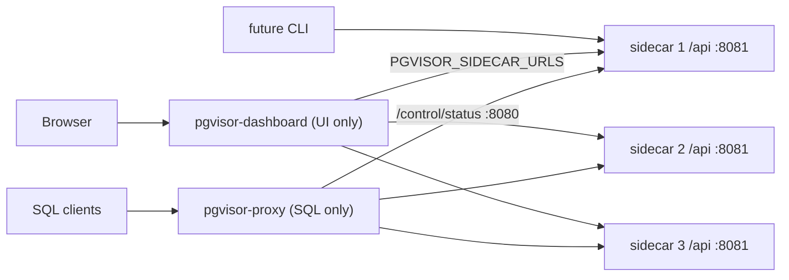

# PLAN: Split dashboard from proxy, move API to sidecar

## Requests (deduped, in dependency order)

1. Move the shared API types and the SQL guard out of `pgvisor-dashboard` so the sidecar, the dashboard and a future CLI can all use them.
2. Add an Axum API to `crates/pgvisor-sidecar/src/api` that uses **Postgres users for login**. `PGVISOR_SUPERUSER=postgres,bob` lists the users who can manage the cluster.
3. Add a sidecar API route, `GET /api/cluster/members`, that lists every sidecar and its role so clients can find the leader.
4. Move every dashboard API handler (reads, then writes) from `pgvisor-dashboard` / `pgvisor-proxy` into the sidecar API.
5. Turn `pgvisor-dashboard` into a standalone UI-only service. It talks directly to sidecars using a list of sidecar URLs.
6. Strip the dashboard out of `pgvisor-proxy` so it only handles SQL connections.

## Current state (from repo exploration)

- `pgvisor-proxy/src/main.rs` embeds the dashboard (`PGVISOR_DASHBOARD_LISTEN`, default `0.0.0.0:8080`). It injects these service implementations:
  - `ProxySqlExecutor` (`executor.rs`)
  - `ProxyBackupService` (`backup.rs`, about 1100 lines)
  - `ProxyClusterService` (`cluster.rs`: switchover, repoint, log/config forwarding)
  - `ProxyMetricsService` (`metrics.rs`)
  - `BackupScheduler` (`scheduler.rs`)
  - `AuditLog`
- `pgvisor-dashboard` contains the router (`lib.rs`) and handlers (`handlers/*.rs`). It defines the service traits (`SqlExecutor`, `BackupService`, `ClusterService`, `UserService`, `MetricsService`) plus `Standalone*` mock implementations, DTOs (`models.rs`), `SqlSecurityGuard` (`security.rs`) and Askama templates. Auth is a single `PGVISOR_ADMIN_TOKEN`.
- `pgvisor-sidecar/src/control/` serves `/control/*` on `PGVISOR_CONTROL_PORT` (default 8080), protected by `PGVISOR_CLUSTER_SECRET` (`cluster_auth_middleware`). Peers come from `PGVISOR_PEERS` (a list of sidecar URLs), and the role lives in `SidecarState.role` (a `String`).
- The sidecar has **no Postgres client**. The wire-protocol client lives in `pgvisor-proxy/src/pool.rs` and `executor.rs`.
- **`pg_hba.conf` is `trust` for all hosts** (`pgvisor-sidecar/src/config.rs::write_pg_hba`). Connecting to Postgres therefore can't verify a password.
- Build and test commands:
  - `cargo build --workspace`
  - `cargo nextest run --test-threads 1 --fail-fast`
  - E2E: `./test.sh` (shell tests in `tests/`, compose files in `composes/`)
  - Frontend: `frontend_tests/` (Playwright, pnpm)

## Target architecture

- `/api/*` (user session auth) runs on its **own listener**, `PGVISOR_API_PORT` (default `8081`). `/control/*` (cluster-secret auth, used only between nodes and by the proxy) stays on `PGVISOR_CONTROL_PORT` (default `8080`). Each listener has its own router, middleware and bind task, so `/control` can stay on an internal network while `/api` is published.
- Only Postgres users listed in `PGVISOR_SUPERUSER` can use `/api`. Anyone else is refused at login and on every request; there is no read-only access.
- Mutating `/api` calls only run on the leader. A non-leader returns `409 NotLeader { leader_url }`, and the client retries against the leader.

---

### Phase 1: Shared API types and SQL guard in `pgvisor-core` [STATUS: DONE]
- Goal: The API contract and the SQL guard live in a crate that the sidecar, dashboard, proxy and future CLI can all depend on.
- Tasks:
  - [x] Create `pgvisor-core/src/api/`, one type per file. Move the DTOs from `pgvisor-dashboard/src/models.rs` into it: `ClusterOverview`, `NodeSummary`, `NodeRole`, `NodeHealthState`, SQL/table/backup/user models, `PgRole`, `TablePrivilege`, `TablePrivilegeKind`.
  - [x] Move `SqlSecurityGuard` (`pgvisor-dashboard/src/security.rs`) to `pgvisor-core/src/sql_guard/`. Leave the admin-token helpers in the dashboard for now.
  - [x] Update imports in `pgvisor-dashboard` and `pgvisor-proxy` (`executor.rs` uses `strip_comments`). No behavior change.
  - [x] Move the existing unit tests with their types (`*_test.rs`).
- Done when: `cargo build --workspace` and `cargo nextest run --test-threads 1 --fail-fast` pass, and the dashboard renders as before.

### Phase 2: Shared Postgres simple-query client in `pgvisor-core` [STATUS: DONE]
- Goal: The sidecar can run SQL against its local Postgres without copying proxy code.
- Tasks:
  - [x] Move the connection setup (`pool.rs::connect` / `connect_with_tls`) and the simple-query and result decoding (`executor.rs`) into `pgvisor-core/src/pg_client/`. It should take user and database parameters.
  - [x] Point `pgvisor-proxy` `pool.rs` and `executor.rs` at the shared client. Remove the duplicated code.
  - [x] Unit-test the result decoding against recorded backend frames.
- Done when: the workspace builds, nextest passes, and `./test.sh` routing/transaction tests still pass.

### Phase 3: Sidecar API skeleton and Postgres-user login [STATUS: DONE]
- Goal: The sidecar serves `/api/*` on its own port. Users log in with a Postgres username and password, and only users in `PGVISOR_SUPERUSER` get in.
- Tasks:
  - [x] Create `crates/pgvisor-sidecar/src/api/` with these files:
    - `mod.rs` (only `mod` lines and re-exports)
    - `router.rs` (`build_api_router`)
    - `server.rs` (`spawn_api_server`)
    - `api_state.rs` (wraps `SidecarState` plus a `pg_client`)
    - `error.rs` (`ApiError`, `thiserror`, `IntoResponse`)
  - [x] Add env `PGVISOR_API_PORT` (default `8081`) and bind the API on a **separate listener** from `/control` (`PGVISOR_CONTROL_PORT`, `8080`). `control/server.rs` is unchanged apart from sharing `SidecarState`. If both ports are set to the same value, startup fails.
  - [x] Add `api_port` to `StatusResponse` (`/control/status`) so peers and the members route can build each node's API URL.
  - [x] Turn the role into an enum: replace the `String` with a `NodeRole`-style enum (`Leader`, `Standby`, `Fenced`) wherever the API reads it. Don't widen this into the election code beyond the accessor.
  - [x] Add `api/superusers.rs`: parse `PGVISOR_SUPERUSER` (comma list, trimmed, deduped). Default is `POSTGRES_USER` (`postgres`).
  - [x] Add `api/password_verifier.rs`: verify the password against the SCRAM-SHA-256 verifier in `pg_authid.rolpassword`, read through a local trust connection. Deny login when `rolcanlogin` is false or no verifier exists.
  - [x] Add `api/session_token.rs`: a stateless, HMAC-SHA256-signed token (username, issued_at, expires_at), signed with `PGVISOR_CLUSTER_SECRET` so every sidecar accepts it after a leader change. Use the `hmac`, `sha2` and `subtle` crates (already workspace deps).
  - [x] Add `api/auth.rs` with the routes and middleware:
    - `POST /api/auth/login`:
      - Check the username against `PGVISOR_SUPERUSER` **before** checking the password.
      - A user not in the list gets `403`, with no token, and the attempt is audit-logged.
      - A wrong password gets `401`.
      - Success returns the token and also sets an HttpOnly cookie.
    - `GET /api/auth/me`: returns `{ username }`.
    - `api_auth_middleware`:
      - Applies to every `/api` route except login.
      - Accepts a Bearer token or the cookie, then **re-checks `PGVISOR_SUPERUSER` on every request**. A user removed from the list, or a token from a sidecar with a different list, gets `403`.
      - Puts the principal into request extensions.
  - [x] Sidecar bootstrap: after `initdb` on the leader, set the `POSTGRES_USER` password from `POSTGRES_PASSWORD` if it is set. Otherwise nobody can log in.
  - [x] Tests:
    - SCRAM verify (known vector)
    - token sign/verify/expiry/tamper
    - env parsing
    - port collision rejected
    - login: 403 for a valid Postgres user not in the list, 401 for a wrong password
    - middleware: 401 (no token), 403 (valid token for a user not in the list), 200
    - `/control/*` not reachable on the API port, and `/api/*` not reachable on the control port
- Done when: nextest passes, and in compose `curl -X POST :8081/api/auth/login` against a node returns a token for `postgres`, `401` for a wrong password, and `403` for a non-superuser Postgres role.

### Phase 4: `GET /api/cluster/members` [STATUS: DONE]
- Goal: A client given any one sidecar URL can find every member and the leader.
- Tasks:
  - [x] Add `api/cluster_member.rs`: `ClusterMember { node_id, api_url, role, health, is_self }`. Put the response types in `pgvisor-core/src/api/` so the CLI can reuse them.
  - [x] Add `api/members.rs`:
    - Fan out to `PGVISOR_PEERS` `/control/status` in parallel, using the cluster secret and a short timeout.
    - Build each `api_url` from the peer's host plus the `api_port` it reports.
    - Mark unreachable peers as `health: Unreachable`. Use local state for self.
    - Return `{ leader_url, members }`. `leader_url` is the leader's API URL.
  - [x] Superusers only, enforced by `api_auth_middleware`.
  - [x] Add `ApiError::NotLeader { leader_url }` returning 409, plus a `require_leader` guard. The later write phases use it.
  - [x] Tests: fan-out with mock peers (axum test servers) covering a healthy peer, an unreachable peer, and the no-leader case.
- Done when: nextest passes, and in compose the route returns the same leader from all three nodes, then the new leader after `./test.sh` failover.

### Phase 5: Port read-only API handlers to the sidecar [STATUS: DONE]
- Goal: Every read endpoint the dashboard uses is served by the sidecar, to superusers only.
- Tasks:
  - [x] Port these handlers, each in its own `api/*.rs` file:
    - `/api/status`, `/api/nodes`
    - `/api/nodes/:id/logs`, `/api/nodes/:id/config/:type` (local, or forwarded to the peer's `/control`)
    - `/api/audit-logs`
  - [x] Add a Postgres activity sampler, `api/pg_activity.rs`:
    - Each sidecar reads `pg_stat_database` from its local Postgres, summed over all databases: `xact_commit`, `xact_rollback`, `tup_returned`, `tup_fetched`, `tup_inserted`, `tup_updated`, `tup_deleted`.
    - Expose the values through `/control/status` as an optional `activity` field in `StatusResponse`, so peers can collect them.
    - Read counters are `tup_returned + tup_fetched`; write counters are `tup_inserted + tup_updated + tup_deleted`. Feed them into `NodeMetrics.pg_reads/pg_writes`. This fixes the per-node counters that are always 0 today.
  - [x] Port `/api/metrics/snapshot` and `/api/metrics/history` to the sidecar:
    - Node telemetry and activity come from peer `/control/status`.
    - Keep the 60-sample, 5s-interval history ring.
    - Replace `ProxyMetrics { reads_total, writes_total }` in `pgvisor-core/src/metrics.rs` with a cluster total: the sum of per-node activity. Rename it, e.g. `ClusterActivity`.
    - Update the dashboard metrics template labels to match.
  - [x] Port the SQL explorer reads: `/api/databases`, `/api/tables`, `/api/tables/:t/schema`, `/api/tables/:t/data`. They run **as the logged-in Postgres user** through `pg_client`, so normal Postgres privileges apply.
  - [x] Port `/api/sql`:
    - Apply the `SqlSecurityGuard` rules.
    - Read-only statements run on any node.
    - Writes need the leader, so a standby returns `NotLeader`.
  - [x] Port the user reads: `/api/users`, `/api/users/:role`, privileges.
  - [x] Port the matching unit tests from `pgvisor-dashboard/src/lib.rs` and `handlers/*`.
  - [x] Unit-test the activity sampler: map `pg_stat_database` rows to read/write counts, sum across nodes, and handle a counter reset.
- Done when: nextest passes, and each read route returns the same data as the proxy dashboard endpoint in compose. The proxy dashboard keeps working unchanged.

### Phase 6: Port cluster, node and user management actions [STATUS: DONE]
- Goal: Cluster operations run on the leader sidecar, superusers only.
- Tasks:
  - [x] Move the `ProxyClusterService` orchestration (`pgvisor-proxy/src/cluster.rs`) into `api/cluster_actions.rs`, using `PGVISOR_PEERS` instead of the proxy's target list:
    - node start/stop/restart/action
    - `/api/cluster/switchover`
    - standby repoint
  - [x] Port the user management writes (create/alter/drop, memberships, privileges) and table row update/delete.
  - [x] Apply `require_leader` to every route above (superuser access is already enforced by `api_auth_middleware`). Record each action in `AuditLog`, with the actor set to the logged-in username.
  - [x] Tests: 403 for a non-superuser token, 409 on a standby, and switchover orchestration against mock peers.
- Done when: nextest passes, and in compose a switchover through the sidecar API succeeds and the proxy follows the new leader.

### Phase 7: Port backup/restore and the restore signal for the proxy [STATUS: TODO]
- Goal: Backups, PITR and restore are orchestrated by the leader sidecar, and the proxy still drains its pool after a restore.
- Tasks:
  - [ ] Move the `ProxyBackupService` logic (`pgvisor-proxy/src/backup.rs`) into `api/backup/`, split by concern. It uses `BackupManager`, the backup lock and peer `/control/restore` / `/control/resync`.
  - [ ] Port every `/api/backups/*` route: list, create, delete, download, upload, restore, quick-restore, best, pitr-window. All are superuser-only. Mutating routes (create, delete, upload, restore, quick-restore) are also leader-only.
  - [ ] Add `restore_epoch: u64` to `StatusResponse`. The leader bumps it after a restore completes. The proxy monitor loop in `pgvisor-proxy/src/main.rs` calls `pool.drain_all()` when the epoch changes, which replaces the direct call.
  - [ ] Move `BackupScheduler` to the sidecar, gated to run only while the node is leader. Keep it **disabled** (env `PGVISOR_SIDECAR_BACKUP_CRON=false`) until Phase 9 so it doesn't double-schedule with the proxy.
  - [ ] Tests: restore orchestration against mock peers, and epoch-triggered drain in the proxy monitor.
- Done when: nextest passes, and `./test.sh` backup-restore/pitr scenarios pass when driven through the sidecar API.

### Phase 8: Standalone dashboard client (side by side with the old one) [STATUS: TODO]
- Goal: The dashboard can run as a UI-only service against the sidecar API. The proxy-embedded version still works.
- Tasks:
  - [ ] Add `pgvisor-dashboard/src/client/`:
    - `sidecar_client.rs` (reqwest): takes a list of `PGVISOR_SIDECAR_URLS`, which are the sidecar **API** URLs (port `8081`, never the control port). It discovers the leader with `/api/cluster/members`, caches it, and on a connection error or `409 NotLeader` re-discovers and moves to the next URL.
  - [ ] Add a new router, `create_client_router`:
    - Pages render server-side from sidecar API calls made with the user's token (cookie).
    - `/api/*` is reverse-proxied: reads go to any healthy sidecar, mutations to the leader. The existing template JS keeps calling relative `/api/...`, so there is no CORS.
  - [ ] Change the login page to username + password. It posts to the sidecar `/api/auth/login` and stores the token in an HttpOnly cookie. On `403`, show "user is not a PgVisor superuser". Every page redirects to login when the sidecar returns `401` or `403`.
  - [ ] Add env `PGVISOR_DASHBOARD_LISTEN` (default `0.0.0.0:8080`).
  - [ ] Tests: `sidecar_client` failover and leader re-discovery against mock axum servers, and login/cookie flow.
- Done when: nextest passes, and the `pgvisor-dashboard` binary pointed at the compose sidecars can log in, show nodes, run SQL and trigger a switchover.

### Phase 9: Cutover: the proxy only handles SQL [STATUS: TODO]
- Goal: Remove the dashboard from the proxy. The dashboard is its own service.
- Tasks:
  - [ ] In `pgvisor-proxy`:
    - Drop the `pgvisor-dashboard` dependency, `PGVISOR_DASHBOARD_LISTEN`, `PGVISOR_ADMIN_TOKEN` and the audit log.
    - Delete `backup.rs`, `cluster.rs`, `executor.rs`, `scheduler.rs` and `metrics.rs` (`ProxyMetricsStore`, `ProxyMetricsService`, `NodeTelemetry`), plus the `record_read`/`record_write` calls in `session.rs`. The sidecar's `pg_stat_database` sampling replaces them.
    - Keep the topology monitor.
  - [ ] In `pgvisor-dashboard`:
    - Delete the old `handlers/*` service traits, the `Standalone*` mocks, `DashboardState`, `security.rs` admin-token code and the old `create_router`.
    - `main.rs` uses `create_client_router`.
  - [ ] Enable the sidecar backup scheduler by default.
  - [ ] Update compose and deployment config:
    - `docker-compose.yml`, `docker-compose.with-tls.yml`, `composes/*.yml`, `stacks/*.yml`:
      - Add a `pgvisor-dashboard` service (`command: ["pgvisor-dashboard"]`, `PGVISOR_SIDECAR_URLS=http://pgvisor-node{1,2,3}:8081`, host port `8080`).
      - Remove the proxy's `8080`.
      - Add `POSTGRES_PASSWORD` and `PGVISOR_SUPERUSER`.
      - Keep node control port `8080` internal. Publish API port `8081` only where a test or CLI needs it.
    - `Dockerfile`: unchanged, it already ships all three binaries.
  - [ ] E2E tests:
    - Add an `api_login` helper to `tests/lib/helper.sh` and `swarm-helper.sh`. Replace the `ADMIN_TOKEN` / `AUTH_HEADER` blocks in `tests/*.sh`.
    - Point `wait_for_proxy_ready` at the dashboard (or a sidecar).
    - Update `test-cluster-auth.sh`:
      - a Postgres role not in `PGVISOR_SUPERUSER` gets `403` at login
      - wrong password gets `401`
      - `/api` is refused on control port `8080`, and `/control` on API port `8081`
    - Update the Playwright specs in `frontend_tests/` if they use the admin token.
- Done when: `cargo build --workspace`, `cargo nextest run --test-threads 1 --fail-fast` and the full `./test.sh` pass. `grep -r pgvisor_dashboard crates/pgvisor-proxy` finds nothing.

### Phase 10: Docs and path-lookup cache [STATUS: TODO]
- Goal: The docs match the new architecture.
- Tasks:
  - [ ] Update `AGENTS.md` (overview and structure: the dashboard is no longer "embedded in the proxy"), `ARCHITECTURE.md`, `README.md`, `DEVELOPMENT.md`, `docs/` and the env var tables: `PGVISOR_SUPERUSER`, `PGVISOR_API_PORT`, `PGVISOR_SIDECAR_URLS`, `POSTGRES_PASSWORD`, removed `PGVISOR_ADMIN_TOKEN` / `PGVISOR_DASHBOARD_LISTEN` on the proxy.
  - [ ] Document the `/api` contract for the future CLI: auth, members, the `NotLeader` retry rule.
  - [ ] Update `.agents/path-lookup/dashboard.md`, `sidecar.md` and `proxy.md`.
- Done when: the docs mention no proxy-embedded dashboard, and the path-lookup entries point to files that exist.

---

## Unknowns, risks, assumptions

- **Assumption (password check):** `pg_hba.conf` is `trust`, so login checks the password against the SCRAM verifier in `pg_authid` instead of connecting with it. The alternative is switching `pg_hba` to `scram-sha-256`, which would also need SCRAM support in the proxy's backend client. That is out of scope.
- **Assumption:** Users without a SCRAM password can't log in, and `POSTGRES_PASSWORD` must be set in every compose file. This **breaks** current setups that rely on `PGVISOR_ADMIN_TOKEN`.
- **Decision:** Only users listed in `PGVISOR_SUPERUSER` can log in or use `/api`; there is no read-only role. The list is checked at login and again on every request. `PGVISOR_SUPERUSER` defaults to `POSTGRES_USER`. SQL from the console still runs as the logged-in Postgres user.
- **Risk:** Every sidecar must have the same `PGVISOR_SUPERUSER`. A mismatch gives `403` on some nodes after the leader changes.
- **Decision:** `/api` listens on `PGVISOR_API_PORT` (default `8081`), separate from `/control` on `PGVISOR_CONTROL_PORT` (`8080`).
- **Assumption:** Session tokens are signed with `PGVISOR_CLUSTER_SECRET`. If the secret is unset, each sidecar generates a random key and logs a warning; tokens then only work on the sidecar that issued them.
- **Assumption:** The dashboard reverse-proxies `/api/*` (a backend-for-frontend) instead of the browser calling sidecars cross-origin. This keeps the existing template JS and avoids CORS, and the dashboard server is still a direct sidecar client. The future CLI calls the sidecar `/api` directly.
- **Decision:** Query metrics come from each node's own `pg_stat_database` instead of the proxy's routed-query counters. The numbers mean something different:
  - They count rows read and written, not statements.
  - They include traffic that skips the proxy.
  - They reset when Postgres restarts or `pg_stat_reset()` runs. The sampler must handle a counter going down by treating the drop as a reset, not as a negative change.
  - On standbys, write counters only rise through WAL replay, not through client writes. This needs checking during Phase 5.
- **Risk:** Phase 9 is the largest commit, because the binary cutover, compose files and e2e harness have to change together to keep `./test.sh` green.
- **Risk:** Moving restore orchestration to the sidecar depends on the `restore_epoch` signal. If the proxy misses the drain, clients keep stale timeline connections (see AGENTS.md "Cluster Restore").
- Out of scope: moving the crates from Rust edition 2021 to 2024 (`AGENTS.md` asks for 2024), and the CLI itself.
