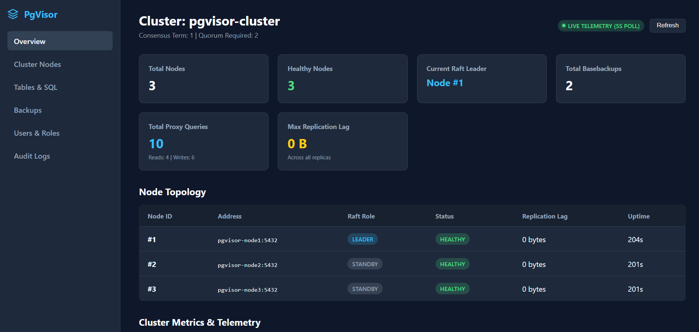

**PgVisor** provides a standalone administrative web dashboard (`pgvisor-dashboard`) listening on port `8080` that communicates directly with the sidecar management API (`/api/*` on port `8081`). `pgvisor-proxy` handles SQL traffic only.



It provides operations teams and developers with real-time cluster visibility, one-click manual failover, backup management, and a guarded SQL console.

---

## Accessing the Dashboard

By default, the dashboard is available on port `8080`:

```text
http://localhost:8080
```

### Authentication

Access to management actions, cluster views, and the SQL runner requires a PostgreSQL user listed in `PGVISOR_SUPERUSER` (comma-separated, default `postgres`):

- **Allowed Superusers**: Set `PGVISOR_SUPERUSER=postgres,bob` on each `pgvisor-sidecar`. Users not listed receive `403 Forbidden`.
- **Password Verification**: Verified against the leader's local `pg_authid` catalog (use your PostgreSQL user password / `POSTGRES_PASSWORD`).
- **Sidecar Discovery**: Configure `PGVISOR_SIDECAR_URLS` on `pgvisor-dashboard` (default `http://127.0.0.1:8081`). The dashboard discovers the active leader via `GET /api/cluster/members` and fails over automatically on `409 Conflict` (`not_leader`).

---

## Dashboard Capabilities

<CardGrid>
  <Card title="Cluster Overview" icon="ph:gauge">
    Live topology view showing current Raft leader, standby replicas, quorum health, and term count.
  </Card>
  <Card title="Manual Switchover" icon="ph:arrow-clockwise">
    Initiate graceful leader step-down or trigger a coordinated failover with zero data loss.
  </Card>
  <Card title="Backup & PITR" icon="ph:hard-drives">
    Browse basebackup snapshots, take on-demand backups, and launch Point-In-Time-Recovery.
  </Card>
  <Card title="Guarded SQL Console" icon="ph:database">
    Interactive SQL runner with strict AST-enforced read-only guards and timeout protection.
  </Card>
</CardGrid>

---

## 1. Cluster Overview & Node Health

The homepage (`/`) provides an instant view of the cluster state:

- **Cluster Topology**: Visual breakdown of all nodes, displaying their roles (`Leader`, `Standby`), network addresses, and Raft peer status.
- **Consensus Quorum**: Active quorum size (e.g. 3 of 3 voting members alive), election term, and leader lease countdown.
- **Replication Lag**: Live byte and time offsets for each streaming standby replica.
- **Uptime & Memory**: Process status and supervisor uptime for each container.

---

## 2. Manual Switchover & Graceful Failover

When performing node maintenance (e.g. OS upgrades, resizing instances), administrators can trigger a graceful switchover:

<Steps>
  <Step title="Navigate to Cluster Management">
    From the dashboard navigation, select **Cluster Operations**.
  </Step>

  <Step title="Choose Target Standby">
    Select the standby replica that should assume leadership.
  </Step>

  <Step title="Execute Switchover">
    Click **Promote**. The dashboard instructs the sidecar to:
    1. Complete WAL flush from current leader to standbys.
    2. Demote leader and release quorum lease.
    3. Promote selected standby via `pg_ctl promote`.
    4. Drain the proxy pool so client transactions migrate to the new leader immediately.
  </Step>
</Steps>

---

## 3. Guarded SQL Console (`/sql`)

The web dashboard embeds an interactive SQL editor designed for inspections. It is protected by a multi-layer **SQL Security Guard**:

### Security Layers

<Tabs>
  <TabItem label="AST Read-Only Enforcement">
    The engine parses statements into an Abstract Syntax Tree (AST). It strictly allows only read-only statements:
    - **Allowed**: `SELECT`, `SHOW`, `EXPLAIN`, `WITH ... SELECT`
    - **Blocked**: `INSERT`, `UPDATE`, `DELETE`, `DROP`, `ALTER`, `CREATE`, `TRUNCATE`, `GRANT`, `REVOKE`, `VACUUM`, `CALL`, `DO`, `COPY`, `SELECT INTO`
  </TabItem>

  <TabItem label="Comment Stripping">
    To prevent SQL comment-based evasion attacks, all single-line (`-- ...`) and block (`/* ... */`) comments are stripped prior to AST parsing and validation.
  </TabItem>

  <TabItem label="Multi-Statement Rejection">
    Queries containing unescaped semicolons (stacked statements like `SELECT 1; DROP TABLE users;`) are rejected before execution.
  </TabItem>

  <TabItem label="Execution Limits">
    - **Statement Timeout**: Enforces a strict 5-second execution timeout via `tokio::time::timeout`.
    - **Row Limit**: Automatically caps query responses at 500 rows to avoid browser memory saturation.
  </TabItem>
</Tabs>

<Aside type="caution" title="Safety">
Any query attempting mutating operations or DDL returns an immediate `PERMISSION_DENIED` error without ever contacting PostgreSQL backends.
</Aside>

---

## 4. Backup & Snapshot Management

The **Backups** tab provides full lifecycle management of cloud backups:

- **Snapshot Catalog**: View all physical basebackup tarballs in object storage, along with their creation timestamp, backup size, base LSN, and timeline ID.
- **On-Demand Backup**: Click **Take Backup Now** to initiate an immediate online basebackup without interrupting active workloads.
- **Point-In-Time-Recovery (PITR)**: Enter a target recovery timestamp to preview available snapshots and trigger an automated cluster-wide restore.

---

## 5. Audit Logging

PgVisor maintains an internal audit log of critical cluster events viewable in the dashboard:

- Consensus leader elections and term transitions
- Node join and departure events
- Graceful switchovers and failover triggers
- Backup completion and restore executions
- Administrative actions and guarded SQL queries
